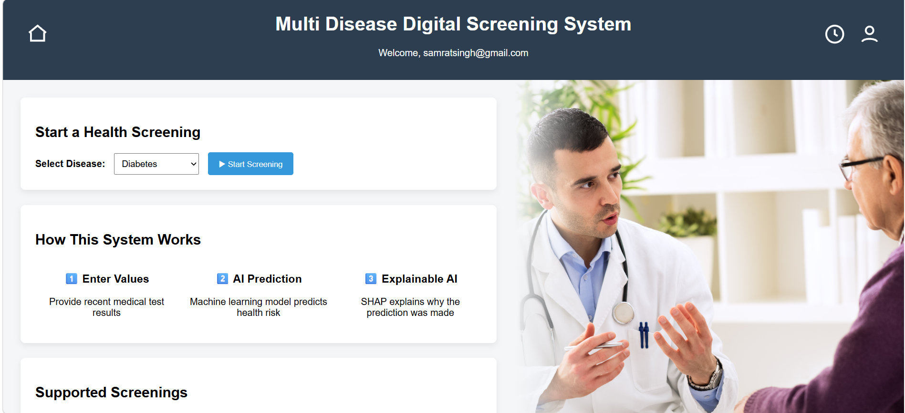
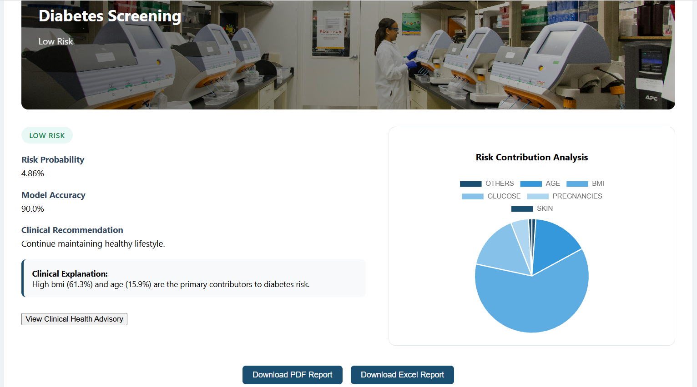

# 🏥 Multi-Disease Digital Screening System

An AI/ML-powered healthcare screening web application that helps users assess their potential risk of **Diabetes, Heart Disease, and Chronic Kidney Disease** using machine learning models.

The system provides risk predictions, probability scores, explainable AI insights, and health suggestions to support early health-risk awareness.

> **Disclaimer:** This application is developed for educational and preliminary health-screening purposes only. It is not a substitute for professional medical advice, clinical testing, or diagnosis.

---

## 📌 1. Project Overview

The Multi-Disease Digital Screening System is designed to make preliminary health-risk assessment more accessible through machine learning.

Instead of developing separate applications for different diseases, this project integrates multiple disease prediction models into a single web-based platform.

Users can select a disease, enter the required health parameters, and receive a prediction along with a risk category and explanations of the factors influencing the result.

The system currently supports three disease-screening modules:

- Diabetes Screening
- Heart Disease Screening
- Chronic Kidney Disease Screening

---

## 🎯 2. Project Objectives

- Develop a centralized platform for multiple disease-risk assessments.
- Apply machine learning algorithms to healthcare datasets.
- Compare different ML algorithms and select suitable predictive models.
- Provide probability-based risk assessments.
- Integrate Explainable AI (SHAP) to improve prediction transparency.
- Maintain user prediction history using a database.
- Generate downloadable health-screening reports.
- Provide health suggestions based on screening results.

---

## 🦠 3. Disease Screening Modules

### 3.1 Diabetes Screening

The diabetes module evaluates the potential risk of diabetes using health parameters such as:

- Pregnancies
- Glucose
- Blood Pressure
- Skin Thickness
- Insulin
- BMI
- Diabetes Pedigree Function
- Age

**Selected Model:** Tuned XGBoost Classifier

### 3.2 Heart Disease Screening

The heart disease module assesses potential heart-disease risk using parameters such as:

- Age
- Sex
- Chest Pain Type
- Blood Pressure
- Cholesterol
- Resting ECG
- Maximum Heart Rate
- Exercise-Induced Angina

**Selected Model:** Tuned XGBoost Classifier

### 3.3 Chronic Kidney Disease Screening

The kidney disease module evaluates kidney-health-related parameters and uses feature engineering to derive additional indicators.

Some engineered features include:

- Renal Function
- Electrolyte Balance
- Blood Health
- Urine Abnormality
- Blood Pressure Score
- Anemia Flag
- Electrolyte Risk

**Selected Model:** XGBoost Classifier

---

## 🤖 4. Machine Learning Approach

Multiple machine learning algorithms were evaluated to identify suitable models for each disease.

Algorithms explored:

1. Logistic Regression
2. Random Forest
3. XGBoost
4. Neural Networks

Hyperparameter tuning was also performed to improve model performance.

### Model Performance

The following are recorded evaluation results from the project experiments.

| Disease | Selected Model | Accuracy |
|---|---|---:|
| Diabetes | Tuned XGBoost | 75.97% |
| Heart Disease | Tuned XGBoost | 80.33% |
| Kidney Disease | XGBoost | 98.75%* |

*The kidney result represents the initial recorded evaluation. Performance should be verified against the final saved model and evaluation dataset before making deployment claims.*

**Note:** These scores are dataset-specific experimental results. They do not represent clinical accuracy or guarantee predictions for individual users.

---

## 🧠 5. Explainable AI (SHAP)

The system integrates SHAP (SHapley Additive exPlanations) to make machine learning predictions more understandable.

Rather than displaying only a prediction, SHAP helps explain which input features contributed most to the model's output.

Key functionality:

- Identifies influential health parameters.
- Displays important contributing features.
- Provides an explanation of the prediction.
- Helps users understand the factors influencing their screening result.

The system also groups less influential features into an "Others" category for simplified explanations.

---

## 📊 6. Risk Classification

The system categorizes prediction probabilities into three risk levels.

| Probability | Risk Category |
|---|---|
| Below 30% | Low Risk |
| 30% to below 70% | Medium Risk |
| 70% and above | High Risk |

The probability represents the model's estimated output, not a medically validated probability of having a disease.

---

## ✨ 7. Key Features

- **User Authentication:** Secure registration and login functionality.
- **Multiple Disease Screening:** Three disease-specific prediction modules.
- **Machine Learning Predictions:** Uses trained and saved ML models.
- **Risk Assessment:** Categorizes results into Low, Medium, and High Risk.
- **Probability Scores:** Displays prediction probabilities.
- **Explainable AI:** Uses SHAP to explain important prediction factors.
- **User Dashboard:** Provides access to screening activities and results.
- **Prediction History:** Stores previous screening records.
- **Report Generation:** Supports PDF and Excel reports.
- **Health Suggestions:** Provides guidance based on screening results.
- **Admin Dashboard:** Supports administrative management.
- **High-Risk Support:** Provides guidance for seeking professional medical assistance.

---

## 🛠️ 8. Technology Stack

| Category | Technologies |
|---|---|
| Programming Language | Python |
| Machine Learning | Scikit-learn, XGBoost |
| Deep Learning | TensorFlow / Keras (where applicable) |
| Explainable AI | SHAP |
| Backend | Flask |
| Frontend | HTML, CSS, JavaScript |
| Templating | Jinja2 |
| Database | PostgreSQL |
| Data Processing | Pandas, NumPy |
| Model Serialization | Joblib / Pickle |
| Report Generation | PDF and Excel libraries |
| Deployment | Gunicorn, Render |

---

## 🏗️ 9. Application Architecture

The application follows a modular Flask architecture to separate different responsibilities.

Conceptual application flow:

```text
                 USER
                   |
                   v
            Flask Web Application
                   |
                   v
             User Authentication
                   |
                   v
             Disease Selection
                   |
        +----------+----------+
        |          |          |
        v          v          v
     Diabetes    Heart      Kidney
      Module    Module      Module
        |          |          |
        v          v          v
     XGBoost    XGBoost    XGBoost
        |          |          |
        +----------+----------+
                   |
                   v
            Prediction Output
                   |
          +--------+--------+
          |        |        |
          v        v        v
       Risk     SHAP     Health
       Level   Insights  Suggestions
          |        |        |
          +--------+--------+
                   |
                   v
             PostgreSQL
                   |
                   v
          History and Reports
```

### Modular Backend Structure

The Flask application is organized into separate components:

- `app.py` – Application entry point and application factory.
- `config.py` – Application configuration.
- `extensions.py` – Flask extensions and database initialization.
- `routes/` – Application routes and endpoints.
- `services/` – Business logic and prediction services.
- `models/` – Trained machine learning models and scalers.

---

## ⚙️ 10. Installation and Setup

Follow these steps to run the project locally.

### Prerequisites

Install the following:

- Python 3.10 or compatible version
- PostgreSQL
- Git
- pip

### Step 1: Clone the Repository

```bash
git clone <YOUR_GITHUB_REPOSITORY_URL>
```

Navigate to the project directory:

```bash
cd multi-disease-digital-screening-system
```

### Step 2: Create a Virtual Environment

```bash
python -m venv venv
```

Activate the environment.

**Windows:**

```bash
venv\Scripts\activate
```

**Linux / macOS:**

```bash
source venv/bin/activate
```

### Step 3: Install Dependencies

```bash
pip install -r requirements.txt
```

### Step 4: Configure Environment Variables

Create a `.env` file in the project root directory.

Configure the required application settings, including:

```env
SECRET_KEY=your_secret_key
DATABASE_URL=your_postgresql_connection_string
```

Add any other environment variables required by your application.

**Important:** Never commit your actual `.env` file or database credentials to GitHub.

### Step 5: Configure PostgreSQL

Create a PostgreSQL database and configure its connection string in the environment variables.

Ensure the application database tables are initialized using the project's database initialization process.

### Step 6: Run the Application

```bash
python app.py
```

Open the application in your browser using the local URL displayed in the terminal.

---

## 📁 11. Machine Learning Model Files

The trained models and their corresponding preprocessing scalers are stored in the `models/` directory.

Important model files:

| File | Description |
|---|---|
| `diabetes_xgboost_final.pkl` | Trained diabetes prediction model |
| `diabetes_scaler.pkl` | Diabetes feature scaler |
| `heart_xgboost_final.pkl` | Trained heart disease model |
| `heart_scaler.pkl` | Heart disease feature scaler |
| `kidney_xgboost_final.pkl` | Trained kidney disease model |
| `kidney_scaler.pkl` | Kidney disease feature scaler |

The saved models allow the application to make predictions without retraining the models every time a user accesses the system.

---

## 🗄️ 12. Database Management

PostgreSQL is used to store application-related information.

The main database tables include:

### Users

Stores user account information, authentication details, and related profile data.

### User Predictions

Stores screening records, including:

- Disease type
- Input health parameters
- Prediction probability
- Risk category
- SHAP explanation
- Health suggestions
- Model information

This allows users to access their previous screening results.

---

## 🔒 13. Security Considerations

The application incorporates security-related practices such as:

- Password hashing.
- User authentication.
- OTP-based verification.
- Environment-based configuration.
- Database-backed user management.
- Separation of application logic into modules.

Since this is a healthcare-related application, sensitive health information should be handled with appropriate privacy, access-control, and data-protection measures before production deployment.

---


## Project Screenshots

### front page


### Disease Prediction



## 🚀 14. Future Enhancements

Possible future improvements include:

- Adding Breast Cancer Screening.
- Adding Liver Disease Screening.
- Improving model performance using larger and more diverse datasets.
- Integrating additional Explainable AI techniques.
- Enhancing the user dashboard and visual analytics.
- Integrating verified healthcare-provider information.
- Improving deployment scalability and monitoring.
- Conducting independent clinical validation before any real-world medical use.

---

## 👨‍💻 15. Project Purpose

This project was developed as an academic and practical implementation of machine learning in healthcare.

It demonstrates how multiple ML models can be integrated into a single web application, how prediction results can be explained using SHAP, and how a database-backed application can manage screening records.

The primary goal is to demonstrate the potential of AI-assisted preliminary health screening and improve awareness of potential health risks.

---

## ⚠️ Medical Disclaimer

This system is an educational machine learning project. Its predictions are not medically validated diagnoses and should not be used to make medical decisions.

Users should consult qualified healthcare professionals for proper medical evaluation, testing, and treatment.

---

**Project:** Multi-Disease Digital Screening System  
**Domain:** Artificial Intelligence | Machine Learning | Healthcare  
**Status:** Development Completed (Academic Project)
